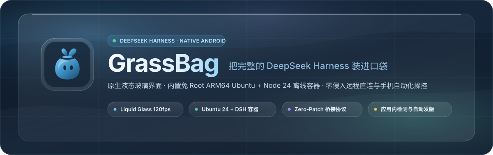
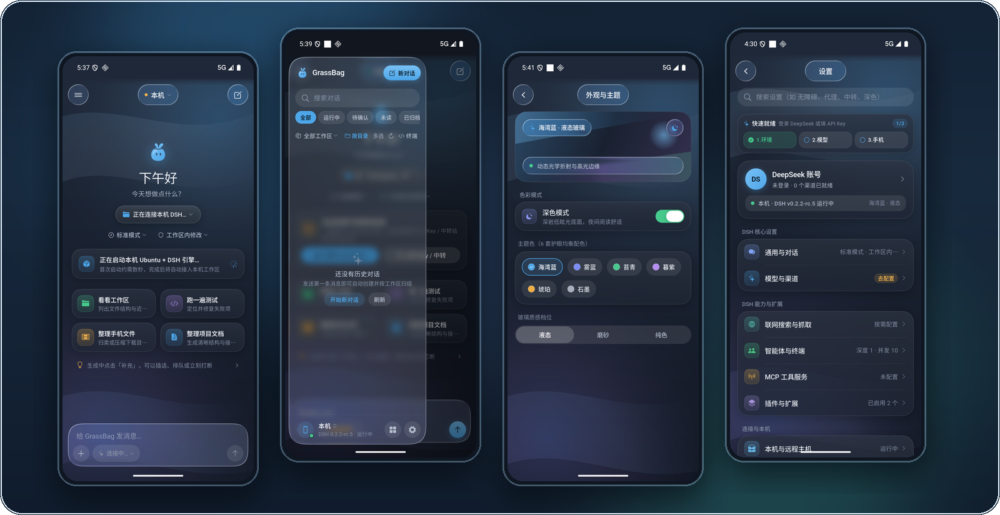
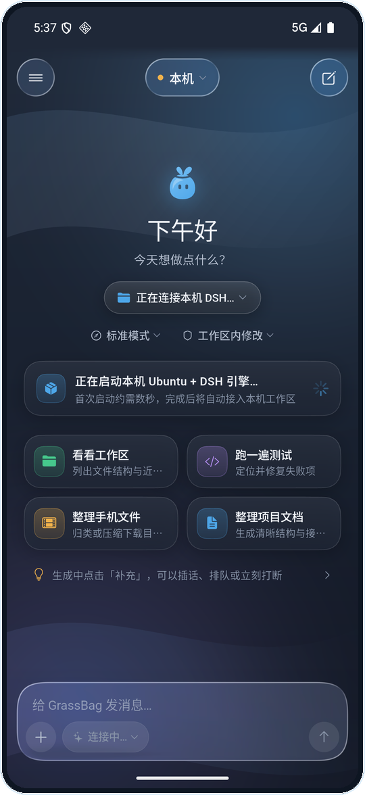
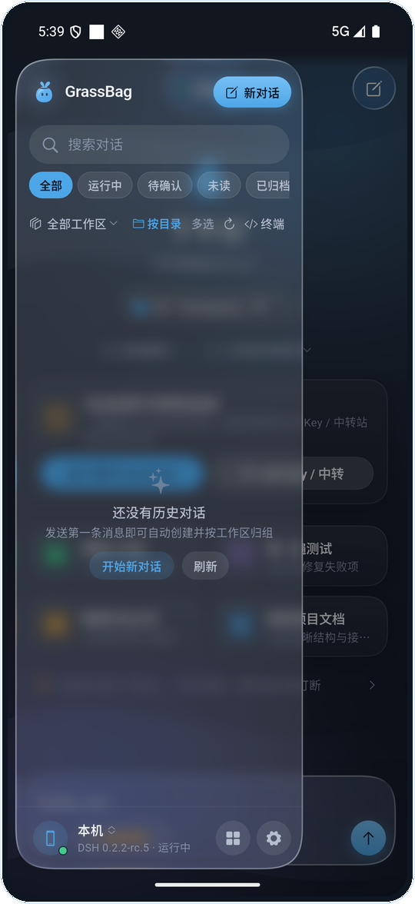
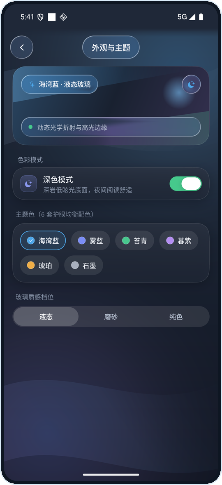
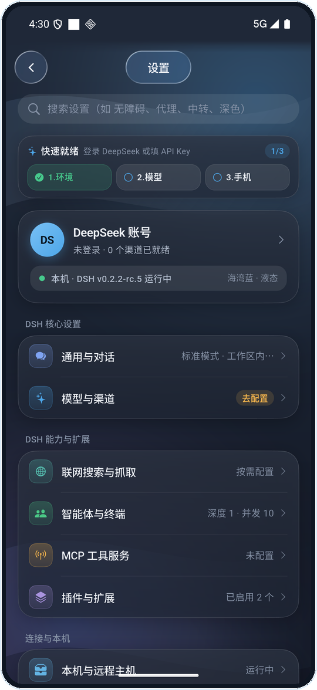
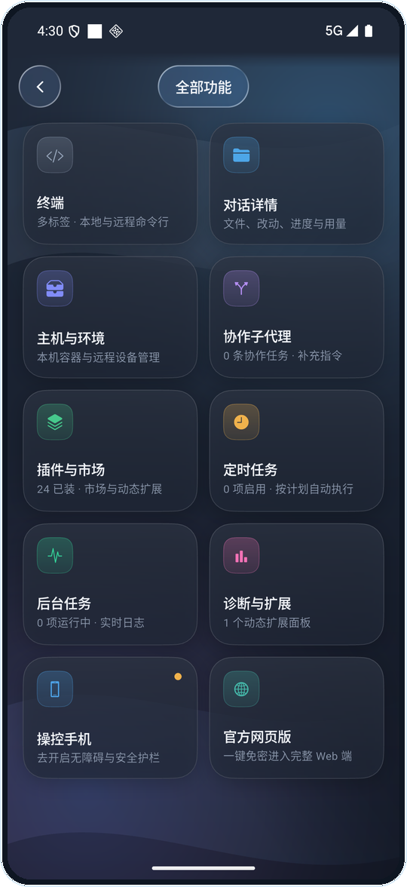
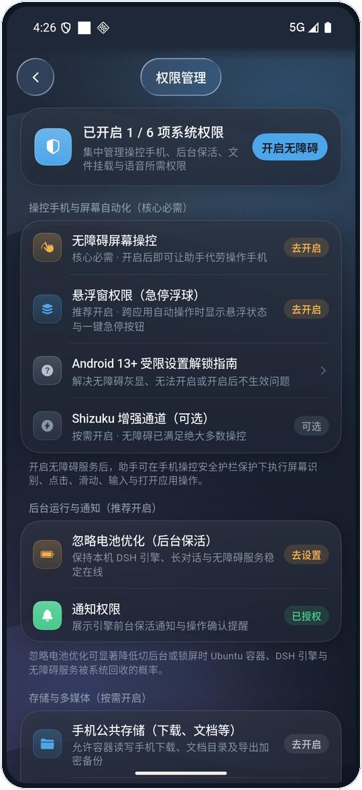
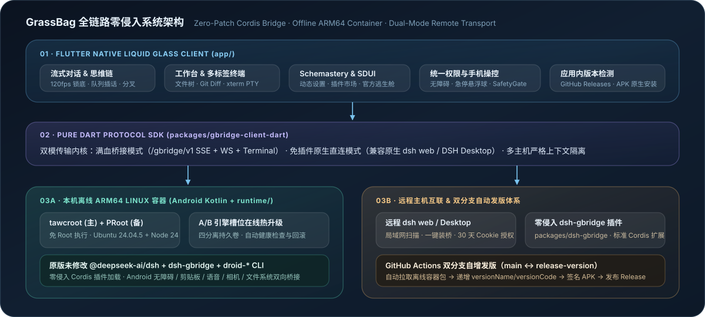
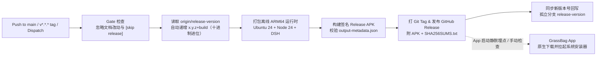

<div align="center">

<picture>
  <source media="(prefers-color-scheme: dark)" srcset="docs/assets/hero-dark.svg" />
  <source media="(prefers-color-scheme: light)" srcset="docs/assets/hero-light.svg" />
  
</picture>

<br />
<br />

[](https://github.com/moduqishi/grassbag/releases/latest)
[](https://github.com/moduqishi/grassbag/actions/workflows/android-release.yml)
[](https://github.com/moduqishi/grassbag/actions/workflows/ci.yml)
[](https://github.com/moduqishi/grassbag/releases)
[](app/pubspec.yaml)
[](LICENSE)

<br />

**把完整的 DeepSeek Harness 装进口袋。**
<br />
不魔改一行上游代码，在手机上离线运行真正的 Ubuntu 24.04 + Node 24 + DSH 核心，
<br />
也能秒连电脑端 `dsh web` 与 DSH Desktop，配合原生液态玻璃界面与全链路手机操控。

<br />

[界面预览](#界面预览) · [核心特性](#核心特性) · [系统架构](#系统架构) · [本机与远程](#本机容器与远程互联) · [自动发版与内测更新](#双分支自动发版与应用内更新) · [本地开发](#本地开发与构建)

</div>

---

## 界面预览

<div align="center">
  
  <br />
  <sub>实机渲染截图：海湾蓝深色主题 · 原生液态玻璃实时光学折射 · 120fps 顺滑交互</sub>
</div>

<br />

<details>
<summary><b>展开查看 6 组细节截图（含功能中心与统一权限管理）</b></summary>
<br />

| 主对话与本机容器启停 | 悬浮液态玻璃会话抽屉 | 外观主题与实时折射画廊 |
| :---: | :---: | :---: |
|  |  |  |
| <sub>一键部署离线 Ubuntu + DSH，快捷任务卡片与沉浸式悬浮输入栏</sub> | <sub>按工作区/时间分组、状态筛选、实时玻璃折射与底层主机状态胶囊</sub> | <sub>6 套护眼配色 + 深浅切换 + 液态 / 磨砂 / 纯色三档质感</sub> |

| 统一设置与快速就绪引导 | 全部功能矩阵 | 统一权限中心与解锁指南 |
| :---: | :---: | :---: |
|  |  |  |
| <sub>3 步就绪进度条、应用内 DeepSeek 账号登录、动态 DSH 命名空间</sub> | <sub>终端、文件 Diff、协作子代理、插件市场、定时任务与官方网页版</sub> | <sub>集中管理无障碍、急停悬浮球、电池保活与 Android 13+ 受限设置</sub> |

</details>

---

## 核心特性

<table>
  <tr>
    <td width="50%" valign="top">
      <h3>Liquid Glass 原生液态玻璃</h3>
      基于 <code>liquid_glass_widgets</code> 深度调校光学折射、高光边缘与微磨砂层次；滚动列表采用零动态读回的纯色与静态缓存策略，兼顾精致通透质感与 <b>120fps 零抽动</b> 对话跟底体验。提供 <b>液态 / 磨砂 / 纯色</b> 三档玻璃质感与 6 套护眼主题色。
    </td>
    <td width="50%" valign="top">
      <h3>免 Root 离线 ARM64 容器</h3>
      内置 <b>Ubuntu 24.04.5 + Node.js 24.22.3 + 原版未修改 <code>@deepseek-ai/dsh</code></b>，由 <code>tawcroot</code>（高速主模式）与 <code>PRoot</code>（兼容备模式）双引擎驱动。采用外置持久卷 + <b>A/B 引擎槽位在线热升级</b>与自动回滚，免重装 App 即可升级内核。
    </td>
  </tr>
  <tr>
    <td width="50%" valign="top">
      <h3>Zero-Patch 零侵入远程互联</h3>
      不修改上游 DSH 源码：既可通过标准 Cordis 桥插件 <code>dsh-gbridge</code>（<code>/gbridge/v1</code>）开启满血体验，也能在<b>远程主机零插件</b>时自动降级为原生直连模式，无缝连接 <code>dsh web</code> 与 <b>DSH Desktop</b>，支持局域网发现、30 天免密 Cookie 授权与多主机严格隔离。
    </td>
    <td width="50%" valign="top">
      <h3>手机操控与统一权限中心</h3>
      通过 <code>droid-*</code> CLI 将 Android 无障碍树、手势操控、通知、相机、剪贴板与共享存储安全桥接进 Agent 工具链。内置 <b>SafetyGate 安全护栏</b>、跨应用<b>一键急停悬浮球</b>以及集中式权限管理页（含 Android 13+ 受限设置分步引导）。
    </td>
  </tr>
  <tr>
    <td width="50%" valign="top">
      <h3>全栈移动工作台</h3>
      手机与平板自适应布局（平板端原汁原味三栏 Split-View）。内置工作区文件树、Git 变更 Diff、多标签 <code>xterm</code> 真实交互终端、协作子代理追踪、定时任务、后台进程日志、Schemastery 动态原生设置与官方 WebUI 逃生舱。
    </td>
    <td width="50%" valign="top">
      <h3>双分支自动发版与内测埋点</h3>
      采用 <code>main</code> + 孤立分支 <code>release-version</code> 双分支版本状态机：推送代码即自动递增 <code>versionName</code> 与单调 <code>versionCode</code>、打包离线容器 Release APK 并发布 GitHub Release；App 内置启动静默检测、更新日志弹窗与原生 <code>FileProvider</code> 一键下载安装。
    </td>
  </tr>
</table>

---

## 系统架构

<div align="center">
  <picture>
    <source media="(prefers-color-scheme: dark)" srcset="docs/assets/architecture-dark.svg" />
    <source media="(prefers-color-scheme: light)" srcset="docs/assets/architecture-light.svg" />
    
  </picture>
</div>

<br />

### Monorepo 目录结构

```text
grassbag/
├─ app/                           # Flutter 原生客户端（Liquid Glass UI + Riverpod 状态 + Android Kotlin 宿主）
│  ├─ lib/services/               #   Native Bridge、GitHub Releases 更新检测与流式 APK 下载器
│  ├─ lib/ui/                     #   对话流、工作台、终端、权限中心、外观画廊、设置与更新弹窗
│  └─ android/                    #   tawcroot / PRoot 容器管理、无障碍服务、FileProvider 安装器
├─ packages/
│  ├─ dsh-gbridge/                # 零侵入 Cordis 桥插件（本机容器与远程主机共用，挂载 /gbridge/v1）
│  ├─ gbridge-client-dart/        # 纯 Dart 协议 SDK（满血桥接 + 免插件原生直连双内核）
│  └─ gbridge-protocol/           # /gbridge/v1 协议契约、JSON Schema 与测试向量
├─ runtime/
│  ├─ scripts/                    # 离线 ARM64 运行时打包脚本（--fetch 自动拉取 Ubuntu/Node/DSH）与 tawcroot 交叉编译
│  └─ shims/                      # android-shim.mjs 与 droid-* 手机操控 CLI 封装
├─ scripts/                       # 双分支版本号自增引擎（flutter_version.mjs / sync_release_version_branch.mjs）
└─ .github/workflows/             # CI 门禁（ci.yml）与全自动 ARM64 Release APK 发版（android-release.yml）
```

---

## 本机容器与远程互联

| 维度 | 本机离线容器（Android ARM64） | 远程满血桥接（`dsh-gbridge`） | 远程免插件直连（`dsh web` / Desktop） |
| :--- | :--- | :--- | :--- |
| **依赖条件** | 仅需安装 Release APK，离线一键解压 | 远程主机加载 `dsh-gbridge` 插件 | 零插件，直接填入 `dsh web` 地址即可 |
| **执行内核** | 内置 Ubuntu 24.04.5 + Node 24 + 原版 DSH | 远程电脑原生进程与完整文件系统 | 远程原生 DSH 服务（兼容 GUI Desktop） |
| **鉴权方式** | 本机回环零配置自动连接 | Token / 智能粘贴 / 网页网关 30 天 Cookie | 网页登录引导 + 30 天 Cookie / Token |
| **核心能力** | 对话、终端、文件、手机操控、A/B 热升级 | 全量协议、文件树、Diff、远程 PTY、SDUI | 实时对话、会话切换、模型配置与一键装桥 |

> **零配置连接技巧**：在「设置 → 本机与远程主机」中直接粘贴带 Token 的局域网或公网 URL，GrassBag 会自动提取主机地址与凭据、自动排除本机 IP，并针对反向代理登录页与自签名证书给出一步直达引导。

---

## 双分支自动发版与应用内更新

GrassBag 使用 **`main`（源码主干）+ `release-version`（孤立版本状态分支）** 管理版本号单调自增，源码提交历史保持绝对干净，不会被机器人自动改版本号的提交污染。



### 发版控制约定

- **推送 `main` 自动发版**：只要 `app/`、`packages/`、`runtime/` 或 `scripts/` 有改动，GitHub Actions 会自动读取 `release-version` 基线，按十进制进位递增补丁号（如 `0.1.0+1 → 0.1.1+2`，`0.1.9+10 → 0.2.0+11`）并发布最新正式版 APK。
- **跳过某次发版**：在提交信息中加入 `[skip release]` 即可跳过 APK 构建。
- **显式主次版本发布**：直接推送标签（如 `git tag v0.2.0 && git push origin v0.2.0`）或在 Actions 页面手动运行 `Android APK Release` 并填入目标版本号；Android `versionCode` 仍保证严格单调递增。
- **App 内更新埋点**：
  - 启动后延迟静默查询 `https://api.github.com/repos/moduqishi/grassbag/releases/latest`（6 小时冷却，零启动卡顿）。
  - 发现新版本后，首页顶部弹出可关闭的液态玻璃更新胶囊，「设置 → 关于与更新」同步亮起更新标识。
  - 点击更新卡片即可查看 Changelog、流式下载 APK 并通过 Android `FileProvider` 直接拉起系统安装器（支持「跳过此版本」持久化记忆）。

---

## 本地开发与构建

### 1. 直接体验（推荐）

前往 [GitHub Releases](https://github.com/moduqishi/grassbag/releases/latest) 下载最新的 `grassbag-v*-arm64-v8a.apk`，安装后即可在 Android 设备上离线部署本机容器或连接远程 DSH 主机。

### 2. 运行全套自动化测试

```bash
# 1. 双分支发版版本号引擎测试
npm run test:release

# 2. 零侵入 Cordis 桥插件单测与契约测试
cd packages/dsh-gbridge && npm test

# 3. 纯 Dart 协议 SDK 静态分析与实时联调测试
cd packages/gbridge-client-dart && dart pub get && dart analyze && dart test

# 4. Flutter 原生客户端静态分析与组件/更新服务测试
cd app && flutter pub get && flutter analyze && flutter test
```

### 3. 本地构建完整离线 / 精简版 ARM64 Release APK

<details>
<summary><b>展开查看运行时打包模式与 Release 签名说明</b></summary>
<br />

Git 仓库不提交 >100 MB 的二进制容器镜像。本地构建 Android APK 前，可按需选择**完整离线包**或**精简按需下载包**：

```bash
# 方案 A（完整离线 APK）：下载并内置 Ubuntu 24.04.5 ARM64、Node 24.22.3 ARM64 与 @deepseek-ai/dsh，
# 生成完整离线 base-arm64.gbag + engine-init.gbag（首次启用本机模式零下载）
bash runtime/scripts/build-runtime-bundle.sh --full --fetch

# 方案 B（精简 APK，与 GitHub Actions 正式发布一致）：仅封装 ~260 KB 桥接/垫片覆盖包与远端校验清单，
# 首次启用本机模式时按需断点续传下载 ~188 MiB 并校验 SHA-256
bash runtime/scripts/build-runtime-bundle.sh --thin

# 构建 ARM64 Release APK（本地无 keystore 时回退 Debug 签名；CI 正式发版强制要求 Release 签名）
cd app && flutter build apk --release --target-platform android-arm64
```

如需在 GitHub Actions 中启用固定 Release 签名密钥，在仓库 `Settings → Secrets and variables → Actions` 配置以下 4 个 Secrets：

| Secret 名称 | 说明 |
| :--- | :--- |
| `ANDROID_KEYSTORE_BASE64` | `.jks` 签名文件的 Base64 编码 |
| `ANDROID_STORE_PASSWORD` | Keystore 密码 |
| `ANDROID_KEY_ALIAS` | 密钥别名 |
| `ANDROID_KEY_PASSWORD` | 密钥密码 |

</details>

---

<div align="center">

Built with care for **DeepSeek Harness** · Licensed under [MIT](LICENSE)

</div>
