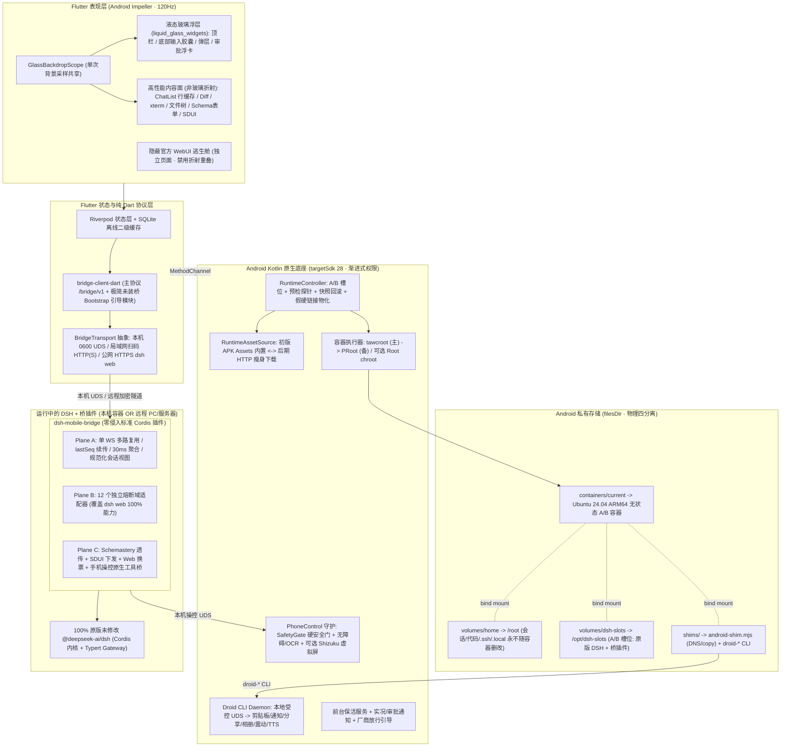
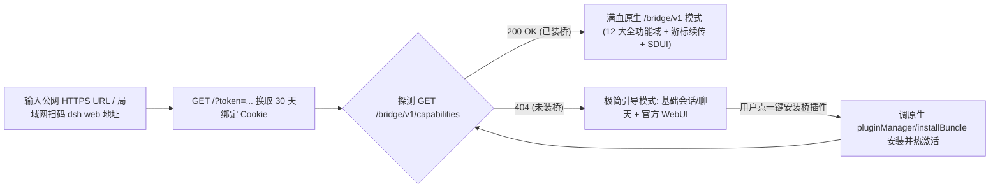

# 自研 Android 原生 DSH 客户端 · 整体架构方案（v2.1 终稿定版）

> **定位**：个人自用的 Android 全功能原生 DSH 客户端。  
> **核心目标**：① **100% 覆盖 `dsh web` 全部能力的极致原生 Flutter UI**（`liquid_glass_widgets` 液态玻璃浮层质感）；② **零侵入上游 DSH（Zero-Patch）**，通过标准 Cordis 桥插件解耦，App 内 A/B 槽位在线免发版升级 DSH 与容器；③ **本机与远程全打通**（输入任意局域网扫码或公网 `dsh web` 地址直连，未装桥主机也可使用基础功能并**一键远程安装桥插件**秒切满血模式）；④ **初版内置容器 + 高可玩性开放 Linux + 手机操控 + 隐蔽官方 WebUI 逃生舱**。

---

## 一、已拍板核心决策总览（全部锁定）

| 决策项 | 最终确定方案 | 架构落点 |
| --- | --- | --- |
| **引擎零侵入与免发版更新** | **100% Zero-Patch**：严禁修改 `@deepseek-ai/dsh` 源码，全部通过独立 **Cordis 桥插件 (`dsh-mobile-bridge`)** 解耦，App 内 A/B 双槽位在线升级 DSH + 桥 | 第四章（混合双平面桥） |
| **远程连接 & 未装桥引导** | **局域网扫码 + 公网 `dsh web` 地址直连**（粘贴/扫码 `http(s)://.../?token=...` 即可连）；连上后先探测桥，**未装桥自动进极简引导模式**（基础对话 + **一键远程安装桥插件** + 官方 WebView），装完秒升满血 `/bridge/v1` | 第四章 §4.2（直连 + 引导升级流） |
| **`dsh web` 全功能覆盖** | 100% 覆盖 68 官方 UI 包 + 32 实验包：核心高频走 **Tier 1 极致原生**，设置/插件/未来新功能走 **Tier 2 Schemastery + SDUI**，极端疑难场景留 **Tier 3 隐蔽 WebUI 逃生舱** | 第五章（全功能映射 & WebUI 逃生舱） |
| **视觉与组件库** | 借鉴 `dsh-Go` 现代克制排版，采用 **`liquid_glass_widgets`** 实现液态玻璃浮层质感，配合严格的 `GlassBackdropScope` 与 GPU 分层守卫保证 120Hz 流畅 | 第六章（Liquid Glass 渲染架构） |
| **Android 权限与手机操控** | 参考 `dsh-Go` 的三档渐进式权限与安全闸门设计；手机操控走**桥原生工具注入 + 原生 `SafetyGate`**（零补丁！） | 第七章（权限矩阵 & 零补丁手机操控） |
| **容器与资料保护** | **`tawcroot` (主) + `PRoot` (备) + 可选 Root `chroot`** 跑 **Ubuntu 24.04 (glibc)**；**初版 APK 内置基础容器**，后续可无痛瘦身；**物理四分离外置持久卷**保证升级零丢数据 | 第八章（容器、首装内置与 A/B 升级） |
| **使用场景与定位** | **个人自用**，不背负第三方社区运营、多端（iOS/鸿蒙）兼容和冗余副业包袱，所有精力聚焦 Android 本机与自用远程设备的极致体验 | 全文 |

---

## 二、总体系统架构图（v2.0）



---

## 三、开发路径（已校准）

沿用你的大顺序，仅把“原型”拆为**低保真 IA（与协议同步定稿）**和**高保真视觉（液态玻璃精修）**两阶段，避免先写完桥插件后因移动端交互需求倒推大改协议：

1. **Phase 1（当前）**：整体架构 v2.0 最终拍板。
2. **Phase 2（低保真 IA 原型 ↔ `/bridge/v1` 契约冻结）**：画出全量页面树、手势流与每页数据粒度，同步冻结 `packages/bridge-protocol`（JSON Schema + 录制样例）。
3. **Phase 3（编写零侵入 `dsh-mobile-bridge` 插件）**：直接在电脑原版 DSH 上开发并跑通全量契约测试（覆盖 12 大功能域 + SDUI + Web 换票 + 手机操控工具桥接口）。
4. **Phase 4（高保真液态玻璃原型 + Flutter 原生 App）**：先连电脑版桥快速把全部 `dsh web` 原生 UI、`liquid_glass_widgets` 质感与 120Hz 流式体验打磨到位。
5. **Phase 5（Android 本机容器 + 内置首装 + A/B 在线升级 + 手机操控与 `droid-*`）**：接入 Kotlin 原生底座，完成离线首装、在线升级/回滚、无障碍操控与多设备切换联调。

---

## 四、核心设计 1：零侵入双平面桥插件（`dsh-mobile-bridge`）

### 4.1 三大平面职责

- **Plane A（稳定核心流与视图面）**：
  - **单条多路复用 WebSocket (`/bridge/v1/stream`)**：承载会话流、审批、提问、后台任务、工作区变动、终端 PTY 二进制 I/O，内置 `zstd/gzip` 帧压缩。
  - **弱网/切后台游标续传 (`resumeFromSeq`)**：服务端内存保留有界环形事件缓冲（如最近 2,000 帧 / 4 MB），App 切回前台带游标毫秒级补帧。
  - **30–50ms 流式聚合**：合并高频 token 碎片和终端刷屏，避免移动端主线程和 GPU 过载。
  - **规范化会话投影**：把 DSH 上游易变的内部 `session-format` 统一映射为冻结的 `v1` 节点模型（`text` / `reasoning` / `tool_call` / `diff` / `deliverable` / `action_card` / `subagent_link` / `usage`）。
- **Plane B（12 个模块熔断域适配器）**：
  - 优先对接 DSH 稳定的 **Typert Gateway** 与公开 Cordis 服务，辅以 Duck-Typing 特性探测，绝不硬编码脆弱私有属性。
  - 12 个域（`auth/models`、`workspaces/files`、`chat/composer`、`approvals/plan/goals`、`subagents/teams/jobs`、`terminal`、`schedule`、`plugins/market/cordis`、`settings/presets`、`experimental`、`sdui`、`web-ticket`）全部独立 `try-catch` 初始化并汇入 `GET /bridge/v1/capabilities`。单域不兼容只优雅降级，永不拖垮主引擎。
- **Plane C（自进化与扩展面）**：
  - **Schemastery 完整透传**：驱动 Flutter 动态原生设置页；
  - **轻量 SDUI 下发**：以后上游 DSH 新增全新交互面板，只更新桥插件即可下发 12 类原子组件树给老 App 原生渲染；
  - **WebUI 换票端点 (`POST /bridge/v1/web-ticket`)**：供隐蔽 WebView 逃生舱一次性安全换取认证 Cookie，票据不落盘、不进 URL 历史；
  - **本机手机操控原生工具桥**（见第七章）。

### 4.2 本机隔离、远程直连与「未装桥自动引导模式」

- **本机安全升级**：使用 `filesDir/run/bridge.sock`（权限 `0600` 的 **Unix Domain Socket**）+ 随机启动令牌，Android 内核 UID 级物理隔绝手机上其他所有 App；仅当打开本机官方 WebView 逃生舱时，才按需走带随机一次性路径令牌的本地 `127.0.0.1` 代理。
- **远程直连（输入任意 `dsh web` 地址或局域网扫码即连！）**：
  - 支持直接粘贴或扫码官方 `dsh web` 启动链接（如局域网 `http://192.168.x.x:3080/?token=...` 或公网反代地址 `https://dsh.example.com/?token=...`，也可配合局域网 mDNS 自动发现）。
  - **一次登录、30 天免重登**：客户端向该地址发起 `GET /?token=<launch_token>`（发送精确 `Host` 头、不发 `Origin` 头），换取与该主机 `authority` 绑定的 `dsh-auth-<hash>` Cookie 存入 Android Keystore；即便远端重启 `dsh web`，30 天内仍自动免密重连。
  - **安全守则**：局域网 Wi-Fi 允许明文 HTTP；**公网地址强烈建议套 HTTPS（如 Caddy / Nginx / Cloudflare Tunnel / Tailscale）**，客户端在检测到非局域网的明文 `http://` 公网 IP/域名时弹出醒目风险提示，防令牌明文泄漏。
- **极简「引导模式（Bootstrap Mode）」——未装桥主机可用 + 一键远程装桥！**
  - 客户端连上任意远程 `dsh web` 后，先探测 `GET /bridge/v1/capabilities`：
    - **返回 `200 OK`**：直接进入**满血原生 `/bridge/v1` 模式**（单 WS 游标续传、12 大全功能域、SDUI、流式聚合）。
    - **返回 `404`（未装桥）**：**不报错、不强迫去电脑敲命令**，自动落入仅 ~300 行代码的**极简引导模式**（只调用上游 DSH 最核心最稳定的 5 组基础端点，绝不维护第二套庞大客户端）：
      1. **一键远程安装桥插件（核心杀手锏）**：顶部弹出优雅的液态玻璃横幅「当前主机未安装桥插件 · 点此一键安装以解锁全部原生功能」，点击即调用上游原生 `POST /api/pluginManager/installBundle`（支持自定义 npm 包名、私有 Registry 或直接指向你的 `.tgz` / Git 仓库地址）+ `waitForInstall` 远程安装并热激活 `dsh-mobile-bridge`！装完自动重探 `/bridge/v1/capabilities`，**零重启秒切满血模式**！
      2. **基础原生聊天可用**：若暂不想/无法给目标主机装插件，仍可通过原生 `session/list`、`session/follow`、`session/prompt`、`session/cancel` 与基础审批完成最核心的看列表、聊天、打断与确认。
      3. **官方 WebUI 逃生舱立即可用**：已拿到该主机有效 Cookie，随时可在 App 内直接打开官方完整网页版。



---

## 五、核心设计 2：`dsh web` 全量原生覆盖 & 隐蔽 WebUI 逃生舱

### 5.1 100% 覆盖策略（基于 DSH `0.2.2-rc.1` 盘点）

- **Tier 1 精雕原生（手写极致体验）**：对话流、Markdown/LaTeX/代码高亮/Diff、思考折叠、单轮收起、凭据脱敏、输入条（`/` `@` 附件 语音 `steer` 插话/排队）、模型与推理档位、审批/提问/计划/待办/长期目标、会话抽屉（工作区/目录浏览/置顶/搜索/归档/批量/导出）、工作区文件树与文档预览（含 Office→PDF）、多标签 `xterm` 终端、轨迹时间线、后台任务、子代理谱系与智能体团队、自动化任务与时钟、账号/余额/订阅登录。
- **Tier 2 动态原生（零更新跟随上游）**：全部内核与第三方插件配置页（**Schemastery → 原生表单**）、插件市场与内置清单、Agent 预设编辑、动态 Cordis 状态与启停、思考翻译、实验性功能（Stats / Forge / Worktree / LiveShare）及未来新增面板（**SDUI 声明式视图**）。
- **Tier 3 隐蔽官方 WebUI 逃生舱（兜底所有未覆盖/极端疑难场景）**：
  - **入口位置（克制且随时可达）**：默认不出现在主顶栏，隐藏在两处次级入口——① 侧栏/主机的「更多（⋯）→ 在官方网页版打开（高级）」；② 设置 → 主机与调试 →「打开当前主机官方 WebUI」（及某个不兼容的第三方 React 插件详情页底部「在网页版打开」）。
  - **本机 + 远程全可用**：本机直连 `dsh web` 临时令牌；SSH 远程经本地转发打开；局域网/加密远程经桥的 `web-ticket` 在 App 内受控 WebView 同源换票打开，**不把登录凭据交给外部浏览器**。
  - **体验微调**：仅注入极轻量的安全区（SafeArea）与移动端 viewport CSS，绝不强行篡改官方 DOM 节点（同时提供「纯净原版开关」防上游前端改版误伤）。

---

## 六、核心设计 3：`liquid_glass_widgets` 液态玻璃 UI 架构与性能守卫

采用 **`liquid_glass_widgets`**（基于真实 Fragment Shader 折射、高光与色散）能让视觉质感直接拉齐旗舰级水平，但在 **Android + 高频流式 AI 聊天** 场景下，如果直接满屏套用玻璃组件，GPU 帧时间会暴涨并导致滚动掉帧和 WebView 黑块。必须从架构层焊死 **5 条视觉与性能铁律**：

### 6.1 视觉分层铁律（Floating Chrome Only）

| 界面层级 | 材质选型 | 具体应用部位 | 原因 |
| --- | --- | --- | --- |
| **浮层交互壳（Floating Chrome）** | **`liquid_glass_widgets` 真实液态玻璃** | 悬浮顶栏胶囊（模型选择/标题/工作台入口）、悬浮底部输入舱（Composer + 思考/待办胶囊）、悬浮审批/提问操作卡、弹出菜单与 BottomSheet 把手栏、平板侧栏悬浮控件 | 元素数量少（每屏 2–4 块）、视觉焦点集中，折射底层滚动消息流效果最惊艳！ |
| **高频滚动内容面（Scrolling Content）** | **原生轻量半透明/实体质感容器（绝不用折射 Shader）** | `ChatList` 每一条消息气泡、工具折叠卡、代码块、Diff 行、文件树行、终端画布、长表单列表项 | 避免几十个列表项重复触发 backdrop blit，确保 120Hz 滚动与高速流式吐字零掉帧 |
| **WebView / PlatformView 页面** | **实色 / 纯色毛边顶栏（禁止液态玻璃重叠）** | 隐蔽官方 WebUI 逃生舱、PDF 原生视图 | 规避 Android `SurfaceView` 无法被 Impeller Shader 正确采样导致的黑块/撕裂 |

### 6.2 工程级性能优化措施

1. **启动期异步预热**：在 `main()` 首帧前调用 `LiquidGlassWidgets.initialize()` 预加载 Shader 字节码，配合原生开屏页衔接，杜绝首次打开聊天页时的编译掉帧。
2. **强制单次采样域 (`GlassBackdropScope`)**：在 `HomeShell` / `ChatScreen` 外层包裹**唯一一个 `GlassBackdropScope`**，让顶栏胶囊、底部输入舱和浮层审批卡**共享同一次背景捕获 Pass**，直接砍掉约 50% GPU 模糊/折射开销。
3. **三档自适应画质抽象 (`AppGlassSurface`)**：业务页面不直接写死 `liquid_glass_widgets` 底层类，而是统一调用封装组件 `AppGlassSurface`，按设备能力与用户偏好自动切换：
   - `Tier.liquid`（默认，Android 10+ Impeller Vulkan 设备）：完整折射 + 动态高光液态玻璃；
   - `Tier.frosted`（Android 8–9 OpenGL ES 降级机 / 中低端 GPU）：`liquid_glass_widgets` 轻量 GLES 模式或低采样高斯模糊；
   - `Tier.solid`（用户开启「省电/极速模式」或系统开启高对比度/减少动态效果）：零模糊纯色高对比卡片。
4. **流式渲染隔离契约**：`ChatScreen` 只 `select` 顶栏/底栏所需的极少字段；流式吐字只在 `ChatList` 内通过 `ChatRowsCache` 局部刷新最后一条 draft，抽屉拖动期间聊天列表与玻璃浮层均不触发不必要的 rebuild。

---

## 七、核心设计 4：Android 渐进式权限体系 & 零补丁手机操控

### 7.1 三档渐进式权限矩阵（参考 `dsh-Go` 最佳实践）

核心原则：**按需触发、绝不在首次启动连环弹窗、严控隐私边界**。

- **L0 基础运行（装机即备 / 按需引导）**：
  - `INTERNET`、`ACCESS_NETWORK_STATE`
  - `FOREGROUND_SERVICE`、`FOREGROUND_SERVICE_SPECIAL_USE`、`WAKE_LOCK`、`REQUEST_IGNORE_BATTERY_OPTIMIZATIONS`（长任务保活）
  - `POST_NOTIFICATIONS`、`POST_PROMOTED_NOTIFICATIONS`（任务完成、审批提醒与 Android 16 实况通知）
  - Manifest 安全加固：`android:allowBackup="false"`（严禁云备份容器明文凭据）、`android:extractNativeLibs="true"`、`tools:node="remove"` 剔除三方库夹带的无关 `READ_PHONE_STATE` 等权限。
- **L1 常用能力（用户点到对应开关/按钮时申请）**：
  - `MANAGE_EXTERNAL_STORAGE`（仅开启「挂载手机存储 `/sdcard`」时）
  - `RECORD_AUDIO`（点击语音输入时）、`CAMERA`（`required="false"`，扫码配对/拍照附件时）
  - `REQUEST_INSTALL_PACKAGES`（App 自身检查更新侧载安装时）
- **L2 极客与手机操控（默认关闭，带明确风险页引导）**：
  - `AccessibilityService`（无障碍读屏与交互）
  - `SYSTEM_ALERT_WINDOW`（手机操控悬浮停止球与屏幕边缘指示光带）
  - `moe.shizuku.manager.permission.API_V23`（Shizuku 通道：Android 14+ 不打扰虚拟屏、受控 `android_shell`、特权更新、解除 32 幽灵进程限制）
  - `com.android.alarm.permission.SET_ALARM`（原生 Intent 设置闹钟/计时器）

### 7.2 比 `dsh-Go` 更干净的「零补丁手机操控」架构

> [!IMPORTANT]
> **关于“直接使用 `dsh-Go` 的操控手机 skill”的澄清与开源合规提示**：
> 1. **技术事实**：`dsh-Go` 的手机操控并不是一个纯文本 `SKILL.md` 插件就能跑起来的——它的 `SKILL.md` 只是给用户和 AI 看的说明文档；真正执行操控的是 **Kotlin 原生层的 `McpServer` + `SafetyGate` + 无障碍/OCR/Shizuku 虚拟屏**，再通过 `--patch` 挂载 MCP 工具注入给 DSH。
> 2. **协议合规**：`dsh-Go` 的 Kotlin 操控代码与文档处于 **AGPL-3.0** 协议下。如果你希望你的项目后续采用 MIT / Apache-2.0 或自主闭源发布，**不要直接拷贝它的源码与文案文件**，而是借鉴其优秀的安全架构与工具接口语义（`screen`/`tap`/`type`/`open`/`intent`/`handoff`/`android_shell`）独立干净实现；如果你的项目同样决定以 AGPL-3.0 开源，则可在遵守署名和许可证条款的前提下复用。

**我们的架构优势（彻底消灭 `dsh-Go` 的 4 个 phone 源码补丁！）**：
- `dsh-Go` 之所以要给 DSH 源码打 `phone-caller.diff`、`phone-run-end.diff` 等 4 个补丁，是因为它用外部 stdio MCP 进程接入，MCP 进程不知道“是哪个会话、哪一轮调了我”以及“这一轮何时结束”。
- **在我们的方案里，`dsh-mobile-bridge` 本身就活在 Cordis 内核里！**
  - 手机操控工具直接由 **桥插件的 Plane C 模块按需注册为标准 Cordis 工具（或带上下文转发的本地 UDS 代理）**，天然就能拿到真实的 `sessionId`、`turnId`、`AbortSignal` 以及 `turn/end` 生命周期事件——**完全不需要改 DSH 一行源码！**
  - 安全防线同样**硬编码在 Kotlin 原生层 `SafetyGate`**（绝不靠提示词防 Prompt Injection）：默认拦截银行/支付 App、系统设置、密码/验证码输入框与本 App 自身界面；三档确认（每次询问 / 本轮允许 / 始终免确认）；任务执行期间禁止放宽任何硬安全限制；随时一键悬浮停止并取消 Agent 回合。

---

## 八、核心设计 5：初版内置 + 后期瘦身的容器与升级管线

### 8.1 统一资产源抽象（无缝衔接“初版内置”与“后期瘦身”）

```text
RuntimeAssetSource（单一抽象接口）
 ├─ BundledApkAssetSource  ◀ v1.0 初版启用：从 APK assets/ 并行解压 Ubuntu Base + 初始 DSH & Bridge
 └─ RemoteHttpAssetSource  ◀ 后续所有在线更新 + 未来瘦身版 APK 首启自动切到此源（架构零重构！）
```

- **初版 APK 内置内容（开箱离线可用）**：
  - `jniLibs/<abi>/`：`libtawcroot.so`、`libproot.so`、`libtalloc.so`、`libandroid-shmem.so`；
  - `assets/runtime/base-<abi>.tar.xz`：Ubuntu 24.04 ARM64 + Node 24 + pnpm + 黄金效率 CLI（`git`/`curl`/`rg`/`fd`/`jq`/`fzf`/`sqlite3`/`tmux`/`zstd`）；
  - `assets/runtime/engine-init.tar.xz`：初始原版 `@deepseek-ai/dsh` + `dsh-mobile-bridge`（首次安装直接展开进 `volumes/dsh-slots/slot-a`）。
  - 解压采用多线程流式校验 + 并行 XZ 解压（`ParallelXZ` 思路），手机端约 20–30 秒完成首装。
- **物理四分离 & 零丢数据升级**（沿用 v1.0 成熟设计）：
  - `volumes/home`（`/root`）与 `volumes/dsh-slots`（A/B 槽位）永远位于 `containers/` 外部，通过目录 bind mount 挂入容器；
  - 升级 DSH + 桥插件 → 后台操作空闲槽位 → `~/.dsh` 轻量快照 → 临时 UDS 预检 `/bridge/v1/capabilities` → 原子切换软链 → 60 秒观察期崩溃自动回滚；
  - 升级/重建容器 → 解压新容器目录 → 物化卷内残留的假硬链接（`tawcroot` linkstore / `PRoot` `.l2s`）→ 预检通过切换软链 → 按 `apt-manifest.json` 提示一键补装用户自定义重型 `apt` 包（如 `ffmpeg`/`pandoc`/`gcc`）；
  - 用户态工具（`uv`/Python/Go/Rust/静态 CLI）默认落在 `/root/.local/bin`，换容器 100% 自动留存；
  - 开放 `/opt/droid-bin/droid-*` 命令桥 + 设置页提供「加密导出会话与配置到 `Download/`」防误卸载丢数据。

---

## 九、v2.1 架构定稿与下一阶段入口（Phase 2）

所有核心架构决策已全部闭环收敛，接下来即可正式进入 **Phase 2（低保真信息架构原型 ↔ `/bridge/v1` 协议契约冻结）**，产出两份互相对齐的工程规格，随后直接开写 `dsh-mobile-bridge` 插件：

1. **低保真移动端信息架构（IA）与页面数据流规范**：梳理出全部页面树（主对话、悬浮输入舱、左抽屉、双档底部工作台/平板右栏、审批/提问流、插件与设置、容器与在线升级页、远程连接与引导装桥页、隐蔽 WebUI 逃生舱）以及每个页面需要拉取和订阅的数据粒度；
2. **`/bridge/v1` 完整协议契约规范**：明确 HTTP 路由表、单 WS 多路复用帧格式（含 `lastSeq` 游标续传、30ms 聚合与错误码）、12 大域数据结构、Schemastery 透传格式、12 类 SDUI 原子组件 Schema，以及极简 Bootstrap 引导模式只依赖的 5 组上游原生端点清单。
