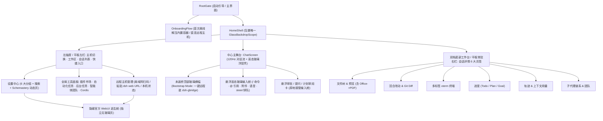
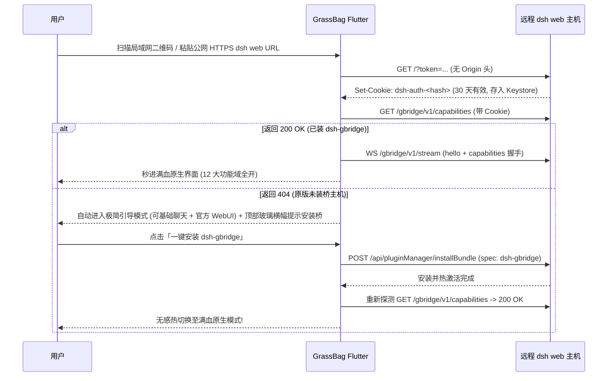

# GrassBag · Phase 2 低保真移动端信息架构（IA）与交互数据流规范

> **命名约定**：App 名称 **GrassBag** · 桥插件包名 **`dsh-gbridge`** · 协议前缀 **`/gbridge/v1`** · 兼容层代号 **`gbridge`**  
> **设计原则**：借鉴 `dsh-Go` 的克制排版与移动端三档自适应布局，结合 **`liquid_glass_widgets`** 实现“浮层液态玻璃 + 内容面 120Hz 纯净渲染”的旗舰体验；所有页面数据需求反向锁定 [phase2_gbridge_v1_spec.md](file:///Users/cake/.gemini/antigravity/brain/0a9a0ae7-c66a-4ec2-8bd9-8bc459fdcf4f/phase2_gbridge_v1_spec.md)。

---

## 一、全局导航骨架与三档屏幕自适应

GrassBag 不做复杂的底部多 Tab 栏（Coding Agent 90% 的停留时间都在对话页），而是以 **对话页为唯一中心舞台**，通过**左抽屉（主机/工作区/会话）+ 顶栏胶囊（模型/会话工作台）+ 底部液态玻璃输入舱**组织全部 `dsh web` 能力：



### 三档响应式形态

| 屏宽断点 | 左侧会话栏 | 中央对话区 | 右侧会话工作台 |
| --- | --- | --- | --- |
| **手机竖屏 (`<600dp`)** | 手势左滑抽屉（边缘滑出） | 全宽内容 + 悬浮玻璃顶栏/底舱 | 点击顶栏标题胶囊或待办条唤起 **双档底部面板（半屏/全屏）** |
| **折叠屏/小平板 (`600–840dp`)** | 宽抽屉或可折叠导轨 | 居中限宽阅读列（`maxWidth: 720dp`） | 加宽双档底部面板 |
| **平板/横屏 (`≥840dp`)** | 常驻左侧栏（可收成窄图标轨） | 自适应主列 | **常驻右侧栏**（可折叠，记住开关状态） |

---

## 二、全量页面树与「`liquid_glass_widgets` 材质边界 + 数据流」映射

> [!IMPORTANT]
> **材质红线**：标为 **💎 Glass** 的组件由 `AppGlassSurface` 渲染（共享 `HomeShell` 外层唯一 `GlassBackdropScope`）；标为 **📄 Flat/Surface** 的滚动列表或 PlatformView **严禁使用折射 Shader**，保证 120Hz 零掉帧与 WebView 无黑块。

### 2.1 主对话舞台 (`ChatScreen`)

```text
┌────────────────────────────────────────────────────────┐
│  💎 悬浮顶栏胶囊: [≡]  [会话标题 · 工作台▾]  [模型/思考]  │  ← liquid_glass_widgets
│  (未装桥时) 💎 横幅: 未装 gbridge · [一键安装] [网页版]   │
├────────────────────────────────────────────────────────┤
│                                                        │
│  📄 对话滚动区 (ChatList · 反向列表 · ChatRowsCache)     │  ← 非玻璃！纯高性能渲染
│     ├─ 用户气泡 (附件缩略图 / @引用胶囊 / 凭据自动遮挡)    │
│     ├─ 折叠的过程行: "已完成 · 4 次工具调用 · 12s ▸"      │
│     │    └─ 展开: 思考Markdown(+翻译) / 工具卡 / 子代理卡 │
│     ├─ 助手正文 (Markdown + LaTeX + 高亮代码块 + Diff卡) │
│     ├─ 产物交付卡 (图片/PDF/文件预览·分享·保存到下载)     │
│     ├─ Action Cards / 桥下发 SDUI 交互卡片              │
│     └─ 消息操作条: 复制 / 分叉 / 重发 / 引用 / 反馈 / ⋯  │
│                                                        │
├────────────────────────────────────────────────────────┤
│  💎 (按需浮现) 待办胶囊 "3/7 正在跑测试" / 长期目标条     │  ← liquid_glass_widgets
│  💎 悬浮输入舱: [+附件] [输入框 (/ @)] [🎤 / 发送·长按队列] │  ← liquid_glass_widgets
│  (有待审批/提问/计划时: 💎 悬浮审批/提问卡原地平滑接管)    │
└────────────────────────────────────────────────────────┘
```

- **数据消费契约（反向锁定 `/gbridge/v1`）**：
  - 首屏秒开：先读本地 SQLite 缓存渲染上次会话；后台建连 WS 订阅 `session:<id>`（带 `resumeFromSeq`）。
  - 历史拉取：按页倒序懒加载 `GET /gbridge/v1/sessions/:id/turns?beforeTurn=&limit=20`，**绝不一次性拉取数千条完整历史**。
  - 工具详情懒加载：折叠的工具卡只下发轻量摘要（工具名、目标、状态、耗时、前 200 字符预览），用户点展开时才按需拉取大段 stdout/diff (`GET /gbridge/v1/sessions/:id/tools/:callId`)。
  - 发送/插话/排队：`POST /gbridge/v1/sessions/:id/messages` 支持 `mode: "auto" | "steer" | "queue" | "interrupt"` + 幂等 `clientRequestId`。
  - 流式聚合：WS `delta` 帧已由桥按 35ms 合并，Flutter 侧仅更新最后一条 `DraftTurn`，历史行零重建。

### 2.2 左侧抽屉 (`SessionsDrawer`)

- **区块结构**：
  1. 💎 **顶部主机身份卡**：当前主机名（本机 Android / 远程主机名）+ 在线/重连/引导模式徽章 + 一键切换主机按钮。
  2. 📄 **工作区切换条**：当前工作区名 + 切换/新建工作区 + 原生目录浏览器入口。
  3. 📄 **搜索与筛选栏**：即时搜标题 + 服务端全文搜索 (`GET /gbridge/v1/sessions/search`)；筛选胶囊（全部 / 运行中 / 待确认 / 未读 / 已归档）。
  4. 📄 **会话列表**：按工作区分组，支持置顶、未读圆点、待审批高亮标签、长按重命名/归档/分叉/导出 ZIP (`/export`)/多选批量操作。
  5. 💎 **底部悬浮功能坞**：`[+ 新对话]` · `[工作台/全部功能]` · `[设置]`。
- **数据消费契约**：WS 订阅 `host` 频道接收 `session.updated` / `session.activity` / `workspace.updated` 增量推送，抽屉展开时不阻塞聊天区。

### 2.3 双档底部工作台 / 平板常驻右栏 (`SessionWorkbench`)

全部 6 个页签均采取**“切到哪个页签才拉取/订阅哪个页签数据”**的懒加载策略：

| 页签 | 对应 `dsh web` 能力 | 按需调用的 `/gbridge/v1` 接口 |
| --- | --- | --- |
| **1. 文件** | `ui-sidebar-files` + `documentpreview` + `deliverables` | `GET /files/tree`、`GET /files/read`、`POST /files/office-preview`（主机转 PDF）、产物列表 |
| **2. 改动** | `dsh-workspace-changes` + 回合 diff | `GET /sessions/:id/changes`（文件级 diff 摘要 → 点击加载 unified diff） |
| **3. 终端** | `ui-sidebar-terminal`（多标签 `xterm`，离页保活） | `GET/POST/DELETE /terminals` + WS 复用频道 `terminal:<termId>`（二进制/UTF-8 I/O + resize） |
| **4. 进度** | `ui-plan` + `ui-goal` + `dsh-tool-todo` | 直接消费 `session` 投影快照（`todos` / `plan` / `goal`）+ `POST /goals/*` |
| **5. 轨迹** | `ui-trajectory` + 上下文占用 + 用量 | `GET /sessions/:id/trajectory`（分页事件表）+ 上下文占比拆解 |
| **6. 子代理** | `ui-subagent` + `experimental-agent-team` + `worktree` | `GET /sessions/:id/subagents`（谱系树，点击直接跳入该子代理对话）+ 团队任务板 |

### 2.4 全局功能页（从抽屉「全部功能」或快捷入口进入）

| 页面 | 覆盖能力 | 核心交互与数据流 |
| --- | --- | --- |
| **远程主机与连接中心** | 局域网扫码 / 粘贴公网 `dsh web` URL / mDNS 发现 / 主机列表 | 粘贴/扫码后执行「换 30 天 Cookie → 探 `/gbridge/v1/capabilities` → 满血或引导模式」；每台主机卡片「⋯」菜单隐藏**「在官方网页版打开」** |
| **插件中心（已装 / 市场 / 清单）** | `ui-plugin-manager`、`ui-plugin-market`、`ui-settings-plugin-inventory` | 已装包启停/卸载/详情配置（Schemastery 动态渲染）；市场浏览与一键安装（WS 频道 `install:<reqId>` 实时流式输出安装日志） |
| **自动化任务 (`Schedule`)** | `ui-schedule` | 全部/开启/结束列表、Cron/RRule/时区原生编辑器、执行历史、立即触发；有活跃任务时在对话顶栏浮现时钟小图标 |
| **后台任务 (`Jobs`)** | `ui-jobs` | 运行中/已结束列表，点开通过 WS `job:<jobId>` 看实时输出与一键 Kill |
| **动态 Cordis 面板** | `ui-cordis` + `cordis/request-run` | 动态插件列表、状态、停止/卸载，以及**原生审批弹窗**响应 `cordis/request-run`（补齐 `dsh-Go` 未原生化的最后一块拼图！） |
| **实验特性 & SDUI 扩展页** | `stats`、`forge`、`liveshare`、未来上游新增模块 | 按 `/capabilities` 动态显隐，直接渲染桥下发的 SDUI 声明式原生组件树 |

### 2.5 设置中心（6 大分组 + 顶部搜索）

1. **AI 与模型**：DeepSeek 账号 OAuth 登录与余额、API Key、ChatGPT/Claude 订阅登录（`appAuth/*`）、自定义渠道、Agent 预设（列表/默认/YAML 编辑）、思考过程翻译开关。
2. **权限与安全**：新对话默认权限预设、当前对话权限、**手机操控开关与原生 `SafetyGate` 规则**（禁止列表/敏感确认档位/Shizuku 虚拟屏开关）。
3. **本机容器与更新（核心亮点页！）**：
   - **DSH 内核与 `dsh-gbridge` 在线管理**：显示当前版本、A/B 槽位状态、一键查新/升最新版/切历史版本/手动回滚 LKG；
   - **Ubuntu 容器底座管理**：执行器切换（`tawcroot` / `PRoot` / 可选 Root `chroot`）、容器大版本升级、一键清理缓存、保留 `/root` 重建容器、`/sdcard` 挂载开关；
   - **一键工具包市场**：Python+`uv` / 多媒体文档 (`ffmpeg`/`pandoc`/`poppler`) / 编译开发 (`gcc`/`go`/`rust`) + `droid-*` 命令桥开关。
4. **引擎参数（100% Schemastery 动态表单）**：子代理、Agent 循环、命令执行、联网搜索、通用设置、日志上传、全部已装插件的自定义配置。
5. **外观与交互**：主题色（亮/暗/跟随壁纸）、字号、**液态玻璃画质档位（`Liquid` / `Frosted` / `Solid` 省电）**、完成后自动折叠过程、通知与后台保活（厂商白名单直达）。
6. **主机与调试（含隐蔽逃生舱）**：诊断日志导出、加密备份 `/root/.dsh` 到 `Download/`、**「打开当前主机官方 WebUI（高级）」**。

---

## 三、关键交互主干流（端到端核对）

### 3.1 远程连接 + 未装桥一键装桥流



### 3.2 审批 / 提问 / Cordis 运行确认流（支持多端并存）

- 当 DSH 触发 `approval/request`、`user-questions/request` 或 `cordis/request-run`：
  1. `dsh-gbridge` 挂在 Cordis waterfall 上，同时给 GrassBag 发高优 WS 事件（并触发后台通知钩子）；
  2. 如果当前有 GrassBag 客户端在线，App 底部输入舱平滑切换为**液态玻璃悬浮审批卡**；用户点「允许/拒绝」→ `POST /gbridge/v1/interactions/:id/respond` → 桥解决 waterfall，通知立即撤回；
  3. 如果用户刚好在电脑 `dsh web` 网页端点了审批，桥收到解决通知立刻广播 `interaction.resolved`，手机上悬浮卡与通知自动消失，绝不留脏卡片！

---

## 四、反向验证清单（确认本 IA 无遗漏）

- [x] 官方 `dsh web` 68 个 UI 包 + 32 个实验包全部有明确归属（Tier 1 精雕 / Tier 2 Schema+SDUI / Tier 3 隐蔽 WebUI）
- [x] 每个高频页面均有明确分页/懒加载边界，避免手机弱网拉爆内存
- [x] `liquid_glass_widgets` 严格限定在浮层交互壳，滚动列表与 WebUI 逃生舱彻底隔离
- [x] 未装桥远程主机可无缝使用基础聊天、官方 WebUI 及一键远程装桥
